# MCLauncher TUI

> 一个 OpenCode 风格的 Minecraft 终端启动器。纯 Go 编写，单文件运行。

[](https://github.com/MoonCC233/MCLauncher-TUI/actions/workflows/ci.yml)
[](https://github.com/MoonCC233/MCLauncher-TUI/actions/workflows/release.yml)
[](LICENSE)


## 功能

- **终端原生 TUI**：Bubble Tea + Lip Gloss，键盘与鼠标操作，窄终端自动收起侧栏；首页标题是四行 ASCII 大字 “MCTL”，带渐变高光，字形（方块 / 线条）与动效（`Sheen` / `Wave` / `Breathe` / `Off`）都能在设置里切换，窄终端自动回退成单行文字。
- **多语言界面**：14 种可选语言，自动跟随系统区域设置；中文、日文、韩文按显示宽度排版，阿拉伯语镜像侧栏、表头与底栏。
- **原版版本安装**：从 Mojang `piston-meta` 获取版本清单，安装 client、libraries、assets、natives 与 log4j 配置。
- **模组加载器**：新建实例时在表单里选择 Fabric、Quilt、Forge、NeoForge 或 OptiFine，加载器会注册为独立版本并通过 `inheritsFrom` 继承原版，实例直接引用该版本；OptiFine 需要本地下载的 `OptiFine_<version>_<edition>.jar`。
- **资源与模组**：在 `Instances` 按 `p` 打开「资源与模组」窗口，`tab` / `←` `→` / 数字键在材质包、光影与模组之间切换。可以从 Modrinth 搜索（按游戏版本与模组加载器过滤），也可以按 `i` 导入本地已下载的文件、按 `u` 粘贴任意 https 直链——从其他网站下载的内容同样能装进来。材质包装入 `resourcepacks/` 并改写 `options.txt` 开关，模组装入 `mods/` 并用 `.jar.disabled` 开关，光影装入 `shaderpacks/` 后在游戏内选择；下载按 SHA-512 校验，手放进目录的文件也会被列出。
- **更新公告与关于页**：启动器会拉取 GitHub Releases，把**当前版本对应的更新日志**用弹窗展示（开发版则显示最新一个 Release），每个版本只弹一次，`a` 可重新查看。侧栏的「关于」里有四个标签：软件信息（版本、Go 版本、平台、数据目录、仓库、许可证）、贡献者名单、历次更新公告（含 Release 说明）以及来自 GitHub issue 的反馈列表，`enter` 可在浏览器里打开对应页面，`n` 直接新建 issue。
- **主题与强调色**：内置 OpenCode、Midnight、Forest、Rose、Mono 五种主题，支持自定义十六进制强调色并即时应用到整个界面。
- **下载镜像**：Settings → Download mirror 可在官方服务器与 **BMCLAPI**（国内镜像）之间切换，切换后版本清单、libraries、assets 以及 Fabric / Quilt / Forge / NeoForge 的元数据和 Maven 依赖都走镜像；镜像缺文件时会自动回退到官方源，不会因此装坏。也可以用环境变量 MCLAUNCHER_FABRIC_MIRROR 等单独覆盖某个源。
- **共享依赖，独立实例**：libraries 和 assets 全局共享，每个实例拥有独立的游戏目录与存档。
- **离线与正版账户**：支持离线账户与 Microsoft 正版登录（device code 流程），可保存多个账户并快速切换；启动时自动刷新过期的 Microsoft 会话。
- **离线皮肤**：在 `Accounts` 选中离线账户按 `s` 打开皮肤窗口，导入 `64×64` 或 `64×32` PNG，选择 `classic` / `slim` 模型，终端里会直接显示半方块人物预览。启动器会把皮肤复制到配置文件旁的 `skins/`，第一次使用时自动下载 authlib-injector，并通过本机回环 Yggdrasil 服务把皮肤注入游戏；也可以随时用任意图片编辑器修改保存的 PNG，回到窗口按 `r` 重新加载。Microsoft 账户继续使用 Mojang 皮肤。
- **Java 运行时管理**：自动扫描 PATH、JAVA_HOME、Windows 注册表、各本地磁盘的常见安装目录以及 IDE 自带运行时，也可手动指定；可在 Java 选择器里下载 Adoptium Temurin JDK 8/17/21，下载优先走 GitHub 镜像；按版本要求选择 Java，并在版本过旧时提示。
- **实例参数覆盖**：全局内存、实例内存、额外 JVM 参数；窗口尺寸提供从 854×480 到 4K 的常用预设，也可手动输入自定义分辨率。
- **可靠的下载**：多线程下载、SHA-1 / SHA-512 校验、原子写入配置文件。
- **控制台**：实时显示游戏 stdout/stderr，支持滚动、清屏、停止游戏和打开日志目录；默认退出启动器时停止由它启动的游戏进程，也可在设置中开启 `Keep game running` 保留游戏。
- **后台任务与下载记录**：安装和游戏启动可发送到后台，在 `Downloads` 页面查看进度、重开进度弹窗或取消任务；最近 20 条任务会持久化到 `downloads-history.json`，重启启动器后仍可查看，可用 `↑` / `↓`、`pgup` / `pgdown` 翻看。
- **版本搜索与分类**：标题右侧的搜索框可按版本 ID 即时搜索；正式版、快照、远古版（Beta / Alpha）与愚人节版独立筛选；正式版和快照分类会自动排除愚人节版本；旧版 assets 的 virtual / map_to_resources 索引也有处理。
- **应用内更新**：在 `Settings` 的 `Launcher version` 行按 `enter` 检查更新；发现新版本后会下载并替换启动器，重启后生效。GitHub 无法直连时会自动尝试镜像，也可以用 `MCLAUNCHER_UPDATE_MIRROR` 指定镜像。
- **便携数据目录**：默认把游戏数据放在当前目录的 `.minecraft`，可在设置中改到任意路径。

## 界面预览

| 版本管理 | 实例管理 |
| --- | --- |
|  |  |

| 控制台 | 快捷键帮助 |
| --- | --- |
|  |  |

| 安装加载器 | 资源与模组 |
| --- | --- |
| 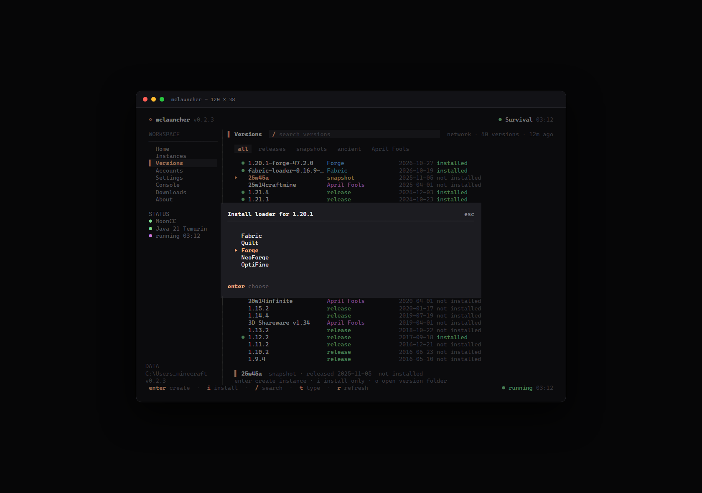 | 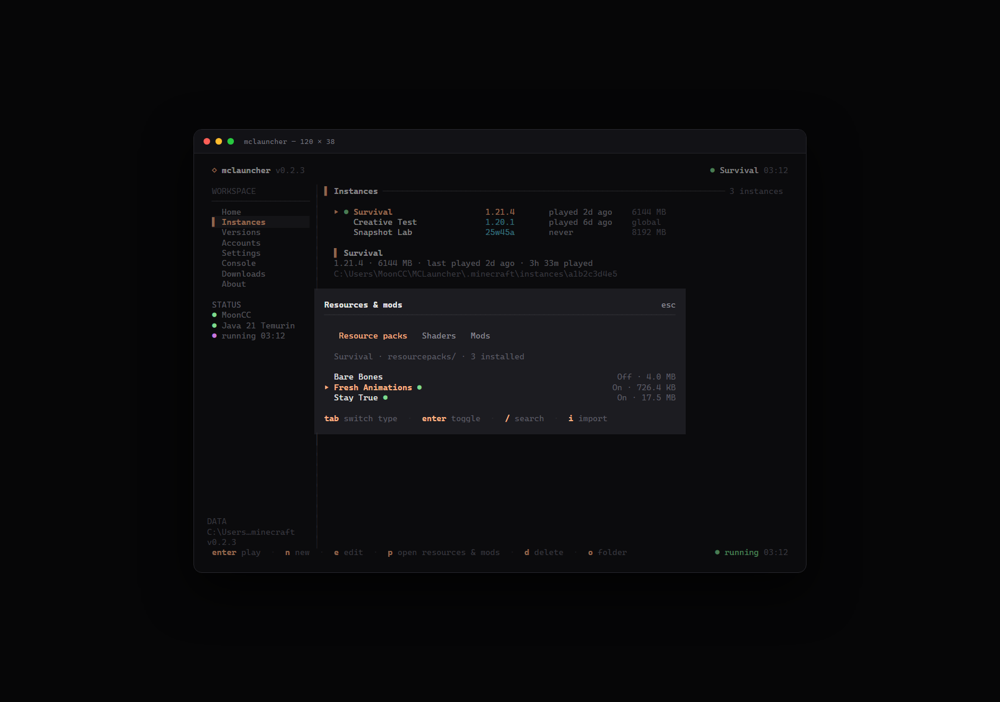 |

| 关于 | 更新公告 |
| --- | --- |
| 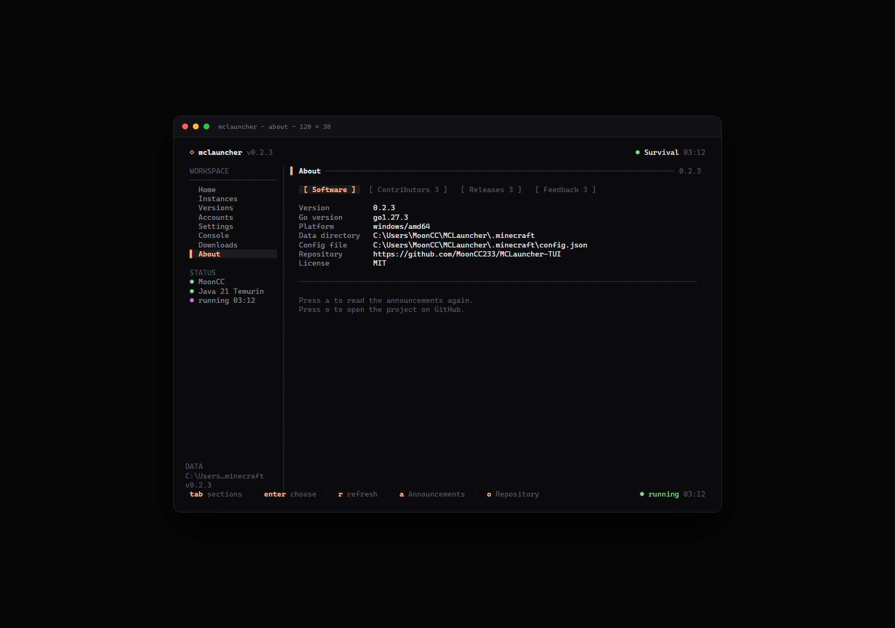 | 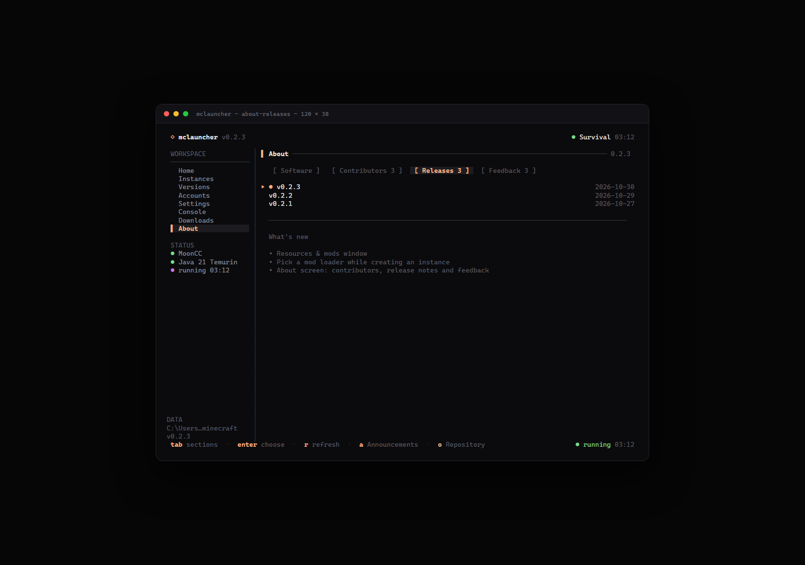 |

<details>
<summary>更多截图</summary>

| 设置 | 账户 |
| --- | --- |
|  |  |

| 新建实例 | 安装进度 |
| --- | --- |
|  |  |

| 账户类型 | 分辨率预设 |
| --- | --- |
| 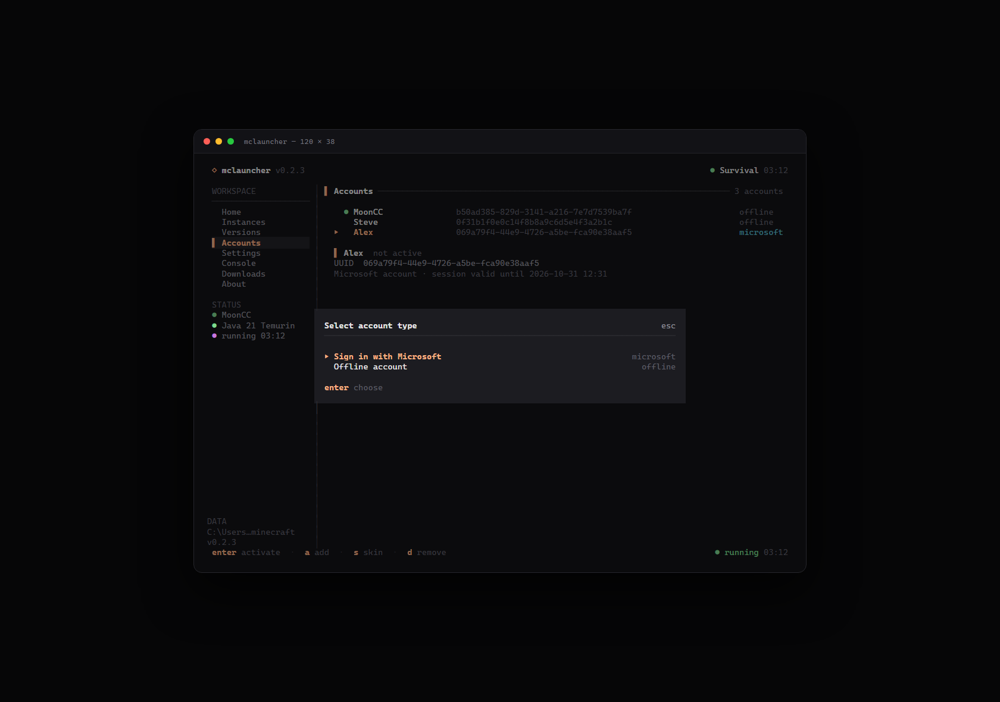 | 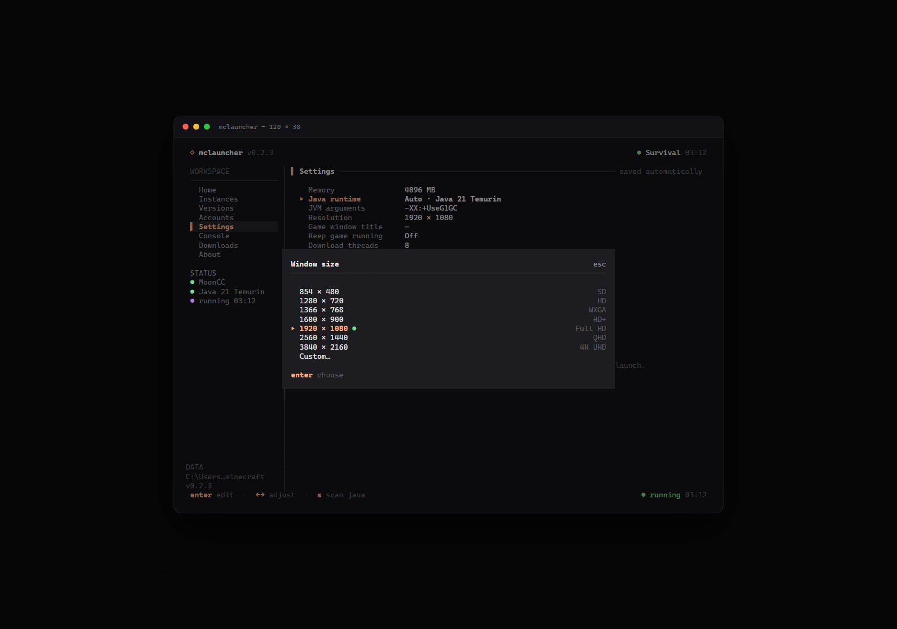 |

| 加载器版本 | 安装器 Java |
| --- | --- |
| 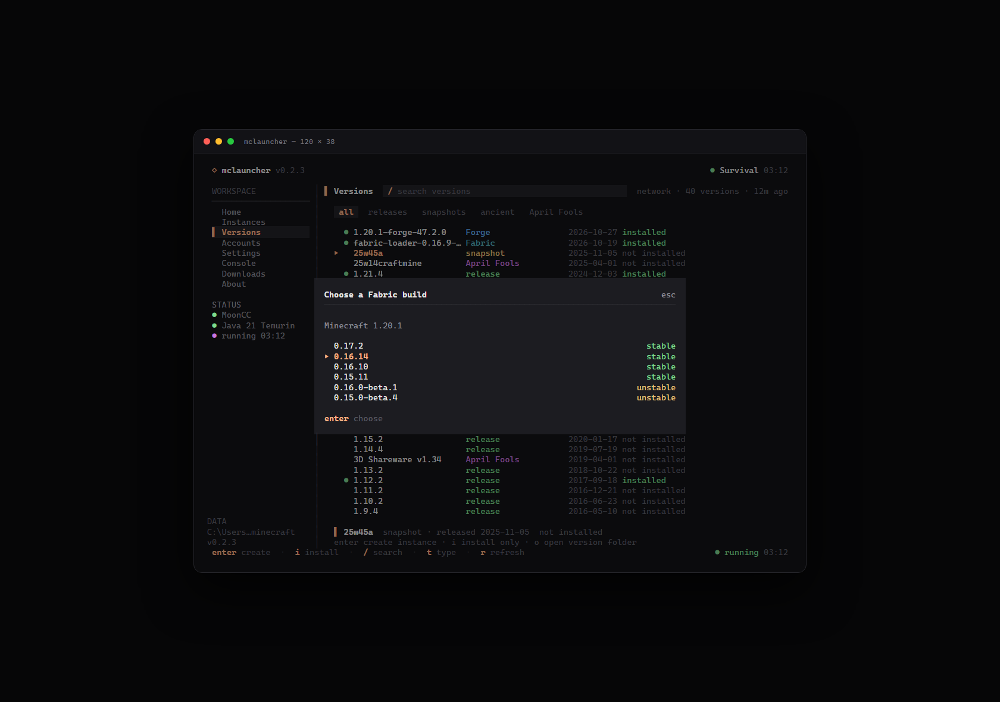 | 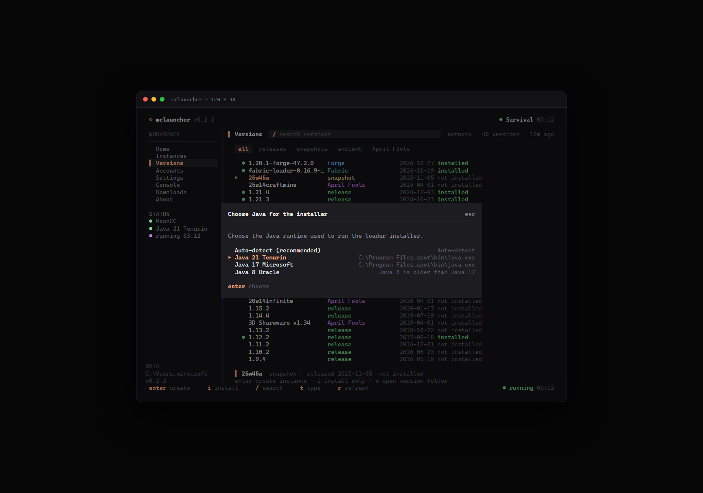 |

| 贡献者 | 反馈 |
| --- | --- |
| 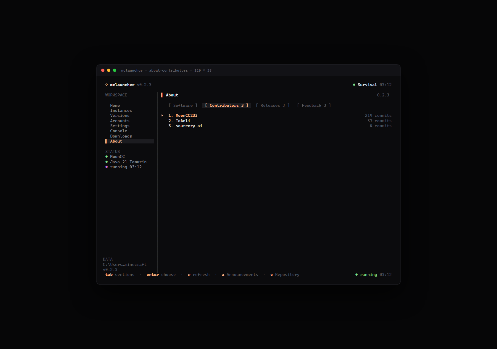 | 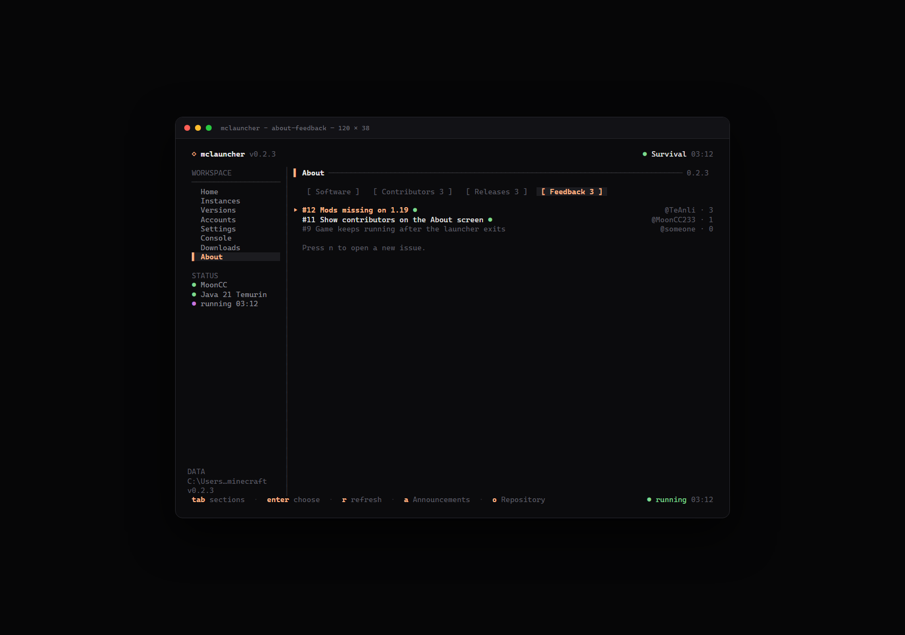 |

| 离线皮肤 | 更新弹窗 |
| --- | --- |
| 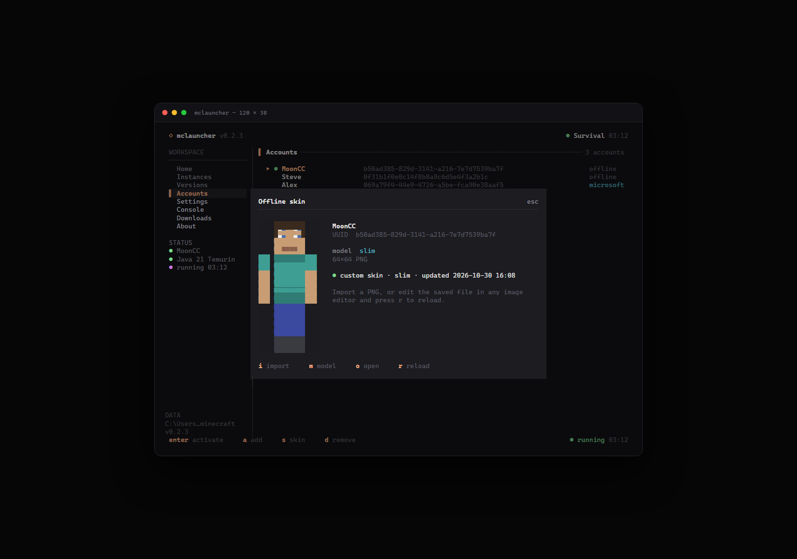 | 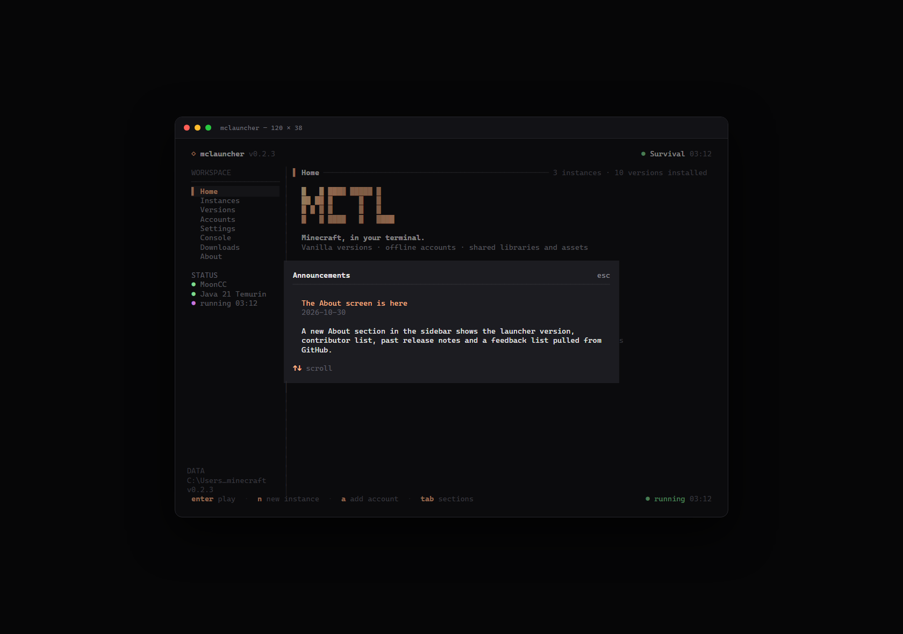 |

</details>

## 安装

### 下载预编译版本

前往 [Releases](https://github.com/MoonCC233/MCLauncher-TUI/releases) 下载对应平台压缩包：

- Windows：`mclauncher_<version>_windows_amd64.zip`（ARM64 也有对应包）
- Linux：`mclauncher_<version>_linux_amd64.tar.gz`
- macOS：`mclauncher_<version>_darwin_amd64.tar.gz` / `arm64`

解压后直接运行：

```bash
# Linux / macOS
chmod +x mclauncher
./mclauncher
```

Windows 建议在 **Windows Terminal** 中运行 `mclauncher.exe`。传统 `cmd.exe` 对 ANSI 颜色和制表符的渲染可能不完整。

### 从源码构建

需要 Go **1.24.2** 或更高版本：

```bash
git clone https://github.com/MoonCC233/MCLauncher-TUI.git
cd MCLauncher-TUI
go build -o mclauncher ./cmd/mclauncher
./mclauncher
```

Windows 下输出文件为 `mclauncher.exe`。

### 前置条件

- **Java**：启动器会扫描已安装的 Java，也可以在 Java 选择器中直接下载 Adoptium Temurin JDK。对应版本要求：
  - Minecraft 1.20.5+ / 1.21.x：通常需要 Java 21
  - Minecraft 1.18–1.20.4：通常需要 Java 17
  - 更旧的版本：通常需要 Java 8
- **网络**：首次加载版本清单和安装版本时需要访问 Mojang 的 `piston-meta`、`piston-data`、`resources`、`libraries` 服务；安装 Fabric/Quilt 加载器需要访问对应的 meta 与 Maven 服务，Forge 需要访问 Forge Maven。中国大陆网络访问这些服务较慢或失败时，可以在启动前设置镜像，例如：
  ```bash
  # 中科大 / CERNET 的 BMCLAPI 直连节点，Maven 下载通常比 BMCLAPI 的 302 跳转更稳定
  MCLAUNCHER_FORGE_MIRROR=https://unicom.mirrors.ustc.edu.cn/bmclapi
  MCLAUNCHER_NEOFORGE_MIRROR=https://unicom.mirrors.ustc.edu.cn/bmclapi
  MCLAUNCHER_FABRIC_MAVEN_MIRROR=https://unicom.mirrors.ustc.edu.cn/bmclapi
  # Fabric 的 meta 列表仍使用 BMCLAPI
  MCLAUNCHER_FABRIC_MIRROR=https://bmclapi2.bangbang93.com/fabric-meta/v2
  # 启动器更新镜像（可选，{url} 会替换为 GitHub 地址）
  MCLAUNCHER_UPDATE_MIRROR=https://gh-proxy.com/{url}
  # 下载 Adoptium JDK 时使用的 GitHub 镜像（可选）
  MCLAUNCHER_JAVA_MIRROR=https://ghfast.top/{url}
  # 下载 authlib-injector 时使用的 GitHub 镜像（可选）
  MCLAUNCHER_AUTHLIB_MIRROR=https://ghfast.top/{url}
  ./mclauncher
  ```

  离线皮肤依赖 [authlib-injector](https://github.com/yushijinhun/authlib-injector)（AGPL-3.0），首次启动带皮肤的离线账户时会自动下载到 `cache/authlib-injector-1.2.8.jar` 并校验 SHA-256。也可以用 `MCLAUNCHER_AUTHLIB_INJECTOR` 指定本地已有 jar（例如更新的版本），启动器会直接使用该文件。

  `MCLAUNCHER_QUILT_MIRROR` / `MCLAUNCHER_QUILT_MAVEN_MIRROR` 可指向 Quilt 的第三方镜像；Quilt 的 profile 也会引用 Fabric Maven，必要时同时设置 `MCLAUNCHER_FABRIC_MAVEN_MIRROR`。Forge/NeoForge 的依赖库会先由启动器下载并校验，然后安装器在离线模式下完成补丁。检查启动器更新和下载 JDK 时也会优先尝试内置 GitHub 镜像（`gh-proxy.com`、`ghfast.top` 等）。镜像由第三方提供，请自行确认可用性与信任程度。
- 现代终端：支持真彩色与完整 Unicode 制表符（Windows Terminal、iTerm2、Kitty、WezTerm 等）。

## 使用流程

1. **添加账户**  
   进入 `Accounts`，按 `a` 选择账户类型：  
   - **离线账户**：输入 3–16 位字母、数字或下划线用户名，按 Java 版离线 UUID 规则生成身份。  
   - **Microsoft 正版账户**：选择 `Sign in with Microsoft`。启动器会申请设备代码并自动打开 `https://www.microsoft.com/link`，在浏览器中输入弹窗里的代码并完成登录；也可以按 `c` 复制代码、按 `r` 重新申请。登录成功后会自动获取 Minecraft 档案、UUID 与 XUID。  
   多个账户可共存，按 `enter` 设为当前账户。  
   选中离线账户后按 `s` 可设置自定义皮肤：`i` 导入 PNG（`64×64` 或 `64×32`），`m` 切换 `classic` / `slim`，`o` 用系统图片查看器打开当前文件，`r` 在外部编辑后重新加载，`d` 移除皮肤。皮肤文件保存在配置文件旁的 `skins/`，启动游戏时由启动器临时启动的本机 Yggdrasil 服务提供；首次使用会自动下载 authlib-injector（约 350 KB）。

2. **安装版本**  
   进入 `Versions`，等待版本清单加载。使用 `/` 搜索，`t` 在“全部 / 正式版 / 快照 / 远古版 / 愚人节版”之间循环切换；愚人节版本会显示紫色 `April Fools` 标签。  
   - `enter`：安装（如果尚未安装）并打开“新建实例”表单。  
   - `i`：仅安装，不创建实例。  
   - `r`：重新拉取 Mojang 版本清单。

3. **选择模组加载器（可选）**  
   在上一步的「新建实例」表单里，按 `tab` 移到「模组加载器」行并按 `enter`，依次选择 Fabric、Quilt、Forge、NeoForge 或 OptiFine，再选择加载器版本与安装用的 Java 运行时。Fabric/Quilt 会下载官方 profile，Forge/NeoForge 会运行 Maven 安装器，OptiFine 需要输入本地 `OptiFine_<version>_<edition>.jar` 的路径。装好后实例会自动指向该加载器版本。
4. **创建并启动实例**  
   在表单中填写实例名、可选内存上限，按 `enter` 创建。回到 `Instances` 或 `Home`，按 `enter` 启动。

5. **管理资源与模组**  
   在 `Instances` 中选中实例按 `p`：材质包 / 光影 / 模组三个标签，`enter` 启用或禁用，`/` 搜 Modrinth，`i` 导入本地 `.zip` / `.jar`，`u` 粘贴 https 直链，`d` 删除。

6. **查看日志 / 停止游戏**  
   进入 `Console` 查看实时输出。按 `x` 停止游戏进程，按 `o` 打开日志目录；直接退出启动器也会先停止正在运行的游戏，不再残留后台进程。

7. **后台任务与下载记录**  
   安装或启动时按 `b` 将任务留在后台，按 `d` 直接打开 `Downloads`。在 `Downloads` 中按 `enter` 重开进度弹窗，按 `x` 取消任务；完成、失败和取消的任务会保留在历史记录中。

8. **调整设置**  
   在 `Settings` 中调整全局内存、Java 运行时、JVM 参数、窗口尺寸、退出时是否保留游戏、下载线程数、下载镜像、游戏窗口标题、界面语言、主题、标题字形、标题动画、数据目录与 Microsoft 客户端 ID。进入某一行按 `enter` 编辑，内存和线程数也可用 `←` / `→` 或 `-` / `+` 调整。
   - **退出时保留游戏**：开启 `Keep game running` 后，退出启动器不会停止 Minecraft；默认关闭，保持退出即停止游戏的行为。
   - **窗口尺寸**：打开常用分辨率预设（854×480、1280×720、1366×768、1600×900、1920×1080、2560×1440、3840×2160），选择 `Custom…` 可手动输入任意 `宽x高`。
   - **游戏窗口标题**：填写后会在游戏窗口出现时改名（目前仅 Windows 支持，通过 Win32 窗口 API 实现）；留空则保持 Minecraft 自带标题。启动器自己的终端窗口标题固定为 `MCLauncher TUI`。
   - **主题**：打开主题选择器，选择预设或 `Custom accent…` 输入十六进制颜色；`Reset accent` 恢复主题默认强调色。  
   - **标题字形**：打开选择器切换首页标题的字形——`Block`（实心方块）或 `Line`（线条 ASCII），选择器里会直接预览当前高亮字形。  
   - **标题动画**：打开选择器切换首页标题的动效——`Sheen`（扫光）、`Wave`（流动）、`Breathe`（呼吸）、`Off`（静态）；也可以直接用 `←` / `→` 循环切换。  
   - **启动器版本**：按 `enter` 检查更新；发现新版本后可下载并替换当前可执行文件，重启启动器完成升级。
   - **Java 运行时**：选择已安装的运行时、输入自定义路径，或在列表底部下载 Temurin JDK 8/17/21；下载优先使用 GitHub 镜像。
   - **数据目录**：留空使用默认 `.minecraft`；也可以输入绝对路径或 `~/...`。切换后会立即重新扫描已安装版本，并保留原有配置文件位置。  
   - **Microsoft 客户端 ID**：留空使用内置公开客户端；只有使用自己注册的 Azure 应用时才需要填写 GUID。自定义 Entra 应用需要获得 Mojang 批准，否则 Minecraft 服务可能返回 403。  
   - **语言**：打开语言选择器，第一项“跟随系统”会跟随操作系统区域设置。

## 快捷键

| 键 | 作用 |
| --- | --- |
| `tab` / `shift+tab` | 切换页面 |
| `1` … `7` | 直接跳转到指定页面 |
| `↑` `↓` / `k` `j` | 移动光标 |
| `pgup` / `pgdown` | 翻页 |
| `home` / `end` | 跳到首项 / 末项 |
| `enter` | 打开、启动或编辑 |
| `esc` | 返回 Home / 关闭弹窗 |
| `?` | 打开快捷键帮助 |
| `ctrl+c` | 退出启动器 |

页面专用按键：

| 页面 | 键与作用 |
| --- | --- |
| Instances | `n` 新建实例 · `e` 编辑 · `p` 打开资源与模组 · `d` 删除（保留游戏文件）· `o` 打开实例目录 · `x` 停止游戏 |
| Versions | 标题右侧搜索框或 `/` 搜索版本 ID · `t` 切换类型（全部 / 正式版 / 快照 / 远古版 / 愚人节版）· `enter` 安装并创建实例 · `i` 仅安装 · `d` 卸载已安装版本 · `r` 刷新 · `o` 打开版本目录 |
| 资源与模组 | `tab` / `1`-`3` 切换材质包、光影、模组 · `enter` 启用或禁用 · `/` 搜索 Modrinth · `i` 导入本地文件 · `u` 添加 https 链接 · `d` 删除 · `esc` 关闭 |
| 关于 | `tab` / `1`-`4` 切换软件信息、贡献者、更新公告、反馈 · `enter` 在浏览器中打开 · `r` 重新加载 · `a` 重新查看公告 · `o` 打开仓库 · `n` 新建 issue |
| Accounts | `a` / `n` 添加账户（离线或 Microsoft）· `enter` 设为当前 · `s` 编辑离线皮肤 · `d` 移除账户 |
| 离线皮肤 | `i` 导入 PNG · `m` 切换 classic / slim · `o` 打开皮肤文件 · `r` 重新加载 · `d` 移除 · `esc` 关闭 |
| Settings | `enter` 编辑 / 检查启动器更新 · `s` / `r` 重新扫描 Java · `←` `→` / `-` `+` 调整数值 · `o` 打开数据目录 |
| Console | `x` 停止游戏 · `c` 清屏 · `o` 打开日志目录 · `G` / `end` 跟随最新日志 · 退出启动器会停止游戏 |
| Downloads | `enter` 重开当前进度 · `x` 取消当前任务 · `↑` `↓` / `pgup` `pgdown` 翻看历史 |

### 鼠标操作

鼠标行为参考 OpenCode TUI：

- **侧栏、标题搜索框、筛选标签、底栏快捷键、弹窗按钮**：单击立即生效。
- **列表行**：第一次单击选中，450 ms 内再次单击才会打开 / 启动 / 编辑，避免误触。
- **滚轮**：滚动实例、版本、账户、设置、控制台、帮助和选择器列表。
- **弹窗**：单击弹窗外部关闭（进度弹窗除外）；表单字段可直接单击聚焦。

键盘操作始终可用，鼠标只是补充。

### 界面语言

支持以下 14 种界面语言：

| 语言 | 代码 | 语言 | 代码 |
| --- | --- | --- | --- |
| English | `en` | Português (Brasil) | `pt-BR` |
| Español | `es` | Português (Portugal) | `pt-PT` |
| Français | `fr` | Русский | `ru` |
| Deutsch | `de` | 한국어 | `ko` |
| 简体中文 | `zh-Hans` | Türkçe | `tr` |
| 繁體中文 | `zh-Hant` | Tiếng Việt | `vi` |
| 日本語 | `ja` | العربية | `ar` |

首次启动时自动检测系统语言；配置中的 `settings.language` 为空表示“跟随系统”。也可以在 `Settings → Language` 中切换，或用命令行参数临时指定：

```bash
./mclauncher --lang zh-Hans
```

`pt-PT` 缺少的条目会回退到 `pt-BR`，再回退到英文。阿拉伯语会镜像侧栏、页头、底栏和表格列；具体字形连写取决于终端字体与 BiDi 支持。技术日志（下载地址、Java 输出、错误详情）保持英文，便于排查问题。

## 数据目录

默认使用**便携模式**：所有游戏数据放在启动器当前工作目录的 `.minecraft` 中，启动器不会写入 `%APPDATA%` 或用户主目录。

```text
<当前目录>/.minecraft/
├── config.json                 # 账户、实例与设置（固定保存在启动根目录）
├── skins/<uuid>.png            # 离线账户的自定义皮肤（跟随 config.json，不随数据目录切换）
├── downloads-history.json      # 最近 20 条安装 / 启动任务记录
├── versions/<id>/              # 版本 JSON、client jar、natives、安装标记
│   └── .mclauncher-loader.json # 加载器类型、版本与基础版本（仅加载器版本）
├── libraries/                  # 全局共享依赖
├── java/                       # 在启动器内下载的 JDK
├── assets/
│   ├── indexes/
│   ├── objects/
│   ├── virtual/                # 旧版本虚拟资源
│   └── log_configs/
├── instances/<id>/             # 每个实例独立的游戏目录（存档、模组、截图等）
│   └── mods/                   # Fabric / Quilt / Forge / NeoForge 模组
├── logs/
└── cache/
```

可以在 `Settings → Data directory` 中把**游戏数据**改到其他位置，例如 `D:\MCLauncher\.minecraft` 或 `~/mc-data`。切换后启动器会立即使用新目录并在下次启动时继续生效；`config.json` 与 `skins/` 仍留在原来的启动根目录，避免改路径后丢失设置和皮肤。清空该设置即可恢复默认 `.minecraft`。下载历史同样保存在数据目录中，切换后会显示新目录的历史记录。

也可以通过环境变量或命令行参数覆盖启动根目录：

```bash
MCLAUNCHER_DATA_DIR=D:\MCLauncher ./mclauncher
./mclauncher --data-dir ./portable-data
```

`--data-dir` 和 `MCLAUNCHER_DATA_DIR` 的优先级高于设置中的自定义路径；使用它们时，`config.json` 和游戏数据都会落在指定目录。

从旧版本升级时，`%APPDATA%\mclauncher`（或其他旧数据目录）不会自动迁移。用 `--data-dir` / `MCLAUNCHER_DATA_DIR` 指向旧目录即可直接沿用旧配置、版本和存档；也可以把旧 `config.json` 复制到当前的 `.minecraft`，再在设置中把游戏数据指向旧目录。

> Microsoft 登录令牌保存在 `config.json` 中（明文 JSON）。请勿把该文件提交到公开仓库或分享给他人；移除账户会同时删除对应令牌。

删除实例只会从启动器配置中移除条目，`instances/<id>/` 中的文件会保留。

## 命令行参数

```text
--data-dir <path>       覆盖数据目录
--lang <code>           指定界面语言（如 zh-Hans、pt-BR、ar）
--version               打印版本并退出
--preview               渲染一帧静态界面到 stdout
--preview-screen <name> home | instances | versions | accounts | skin | settings | console | downloads | help | form | progress | theme | language | java | account-type | microsoft | microsoft-error | resolution | loader | loader-versions | loader-java | content | about | about-contributors | about-releases | about-feedback | announce
--width <n>             预览宽度（默认 120）
--height <n>            预览高度（默认 38）
```

`--preview` 不需要真实终端，适合在 CI 或文档构建中生成界面截图。

## 开发

```bash
gofmt -w .
go vet ./...
go test ./...
go build ./...
```

参与贡献（构建、测试、界面文案与提交约定）请阅读 [CONTRIBUTING.md](CONTRIBUTING.md)。

项目结构：

```text
cmd/mclauncher/         程序入口、参数解析、配置引导
internal/tui/           Bubble Tea 模型、页面、弹窗、鼠标命中区域与预览数据
internal/i18n/          界面语言目录、区域设置检测、复数与相对时间
internal/mojang/        版本清单、规则判断、参数替换、依赖解析、版本继承合并、natives 解压
internal/install/       下载、校验、资源索引与安装标记
internal/loader/        Fabric / Quilt / Forge / NeoForge / OptiFine 安装与加载器元数据
internal/mods/          模组扫描、元数据解析、启用/禁用与删除
internal/packs/         资源包、光影与模组的安装、启停和目录扫描
internal/catalog/       Modrinth 搜索与下载元数据
internal/skin/          离线皮肤校验、终端预览、本机 Yggdrasil 服务与 authlib-injector 下载
internal/gametitle/     Windows 游戏窗口标题修改
internal/remote/        GitHub Releases、贡献者、issue 与更新公告读取
internal/update/        GitHub Release 检查、镜像下载与启动器替换
internal/launch/        Java 命令行构建、进程启动、输出流
internal/java/          Java 运行时扫描、版本解析、选择与 JDK 下载
internal/config/        配置持久化、账户与实例管理
internal/auth/          离线用户名校验、离线 UUID、Microsoft OAuth / Xbox / Minecraft 登录
internal/paths/         数据目录布局
internal/util/          路径安全、原子 JSON、参数解析、格式化
internal/version/       版本注入
scripts/ansi2html.go    预览 ANSI 转 HTML（生成文档截图用）
```

生成文档截图（Windows + Edge 示例）：

```powershell
go build -o mclauncher.exe ./cmd/mclauncher
# PowerShell 的 > 默认写 UTF-16；用 cmd /c 生成 UTF-8 的 ANSI 预览
cmd /c "mclauncher.exe --preview --preview-screen home --width 120 --height 38 > preview-home.ansi"
# 生成中文界面预览
cmd /c "mclauncher.exe --preview --lang zh-Hans --preview-screen settings --width 120 --height 38 > preview-settings-zh.ansi"
go run scripts/ansi2html.go preview-home.ansi preview-home.html mclauncher
# 再用浏览器无头模式将 preview-home.html 渲染为 PNG
```

## 发布

发布说明写在 `docs/releases/vX.Y.Z.md`，提交并推送 `main` 后再推送 `v*` 标签：

```bash
# 1. 编写并提交发布说明
git add docs/releases/v0.2.0.md
git commit -m "docs: add v0.2.0 release notes"
git push

# 2. 打标签并触发发布
git tag -a v0.2.0 -m "v0.2.0"
git push origin v0.2.0
```

Release 工作流会读取对应标签的 `docs/releases/<tag>.md`，通过 GoReleaser 的 `--release-notes` 写入 Release 页面；说明文件缺失时工作流会直接失败，确保每个版本都有更新详情。

发布流水线会构建以下目标，并生成校验和：

- `windows/amd64`、`windows/arm64`
- `linux/amd64`、`linux/arm64`
- `darwin/amd64`、`darwin/arm64`

压缩包内含 `mclauncher` 可执行文件、`README.md` 和 `LICENSE`。

## 已知限制

- **Microsoft 登录依赖网络与浏览器**：设备代码流程需要访问 Microsoft 登录页；部分账户首次使用前可能需要先在 `xbox.com` 创建 Xbox 档案。自定义 Entra 客户端需要 Mojang 审批，内置客户端开箱即用。
- **材质包不检查 `pack_format`**：搜索与下载会按实例的游戏版本过滤，但兼容性最终由 Minecraft 判断，不匹配的包在游戏内会显示为不可用；光影需要 Iris 或 OptiFine，模组需要对应的加载器。
- **阿拉伯语显示取决于终端**：启动器会镜像布局，但阿拉伯文字形连写和 BiDi 排序由终端与字体决定；Windows Terminal 的显示效果通常最好。
- **预编译二进制未签名**：macOS 首次运行可能需要 `xattr -d com.apple.quarantine ./mclauncher`。

## 致谢

界面风格受 [OpenCode](https://github.com/sst/opencode) 启发；TUI 基于 [Bubble Tea](https://github.com/charmbracelet/bubbletea)、[Bubbles](https://github.com/charmbracelet/bubbles) 和 [Lip Gloss](https://github.com/charmbracelet/lipgloss)。

本项目与 Mojang Studios / Microsoft 无关联。使用 Minecraft 客户端及资源时请遵守 [Minecraft EULA](https://www.minecraft.net/eula)。

## License

[MIT](LICENSE) © 2026 MoonCC233
