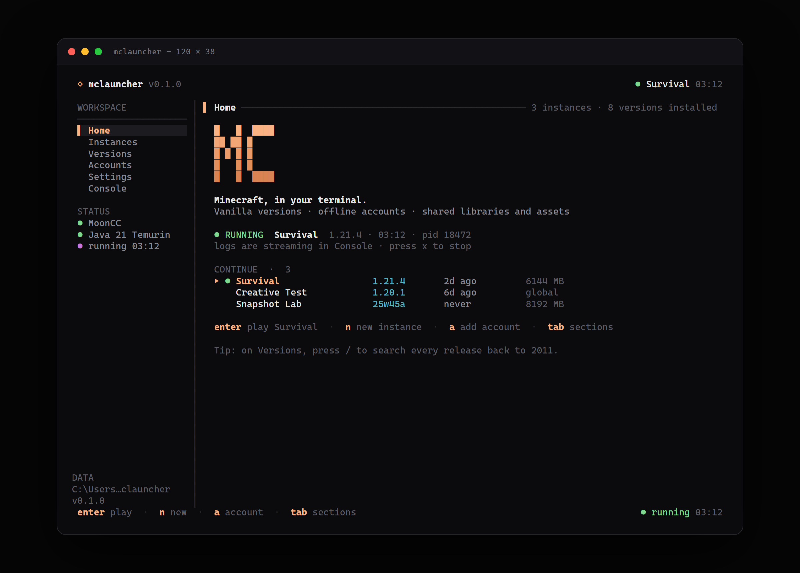
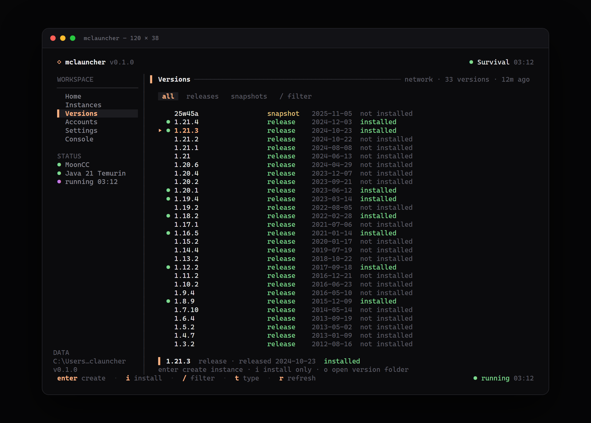
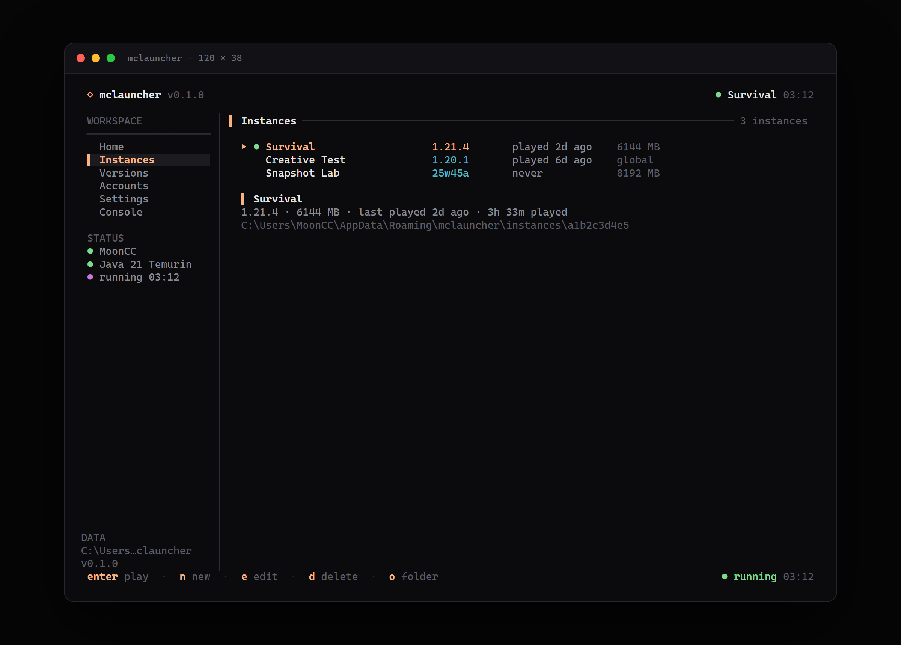
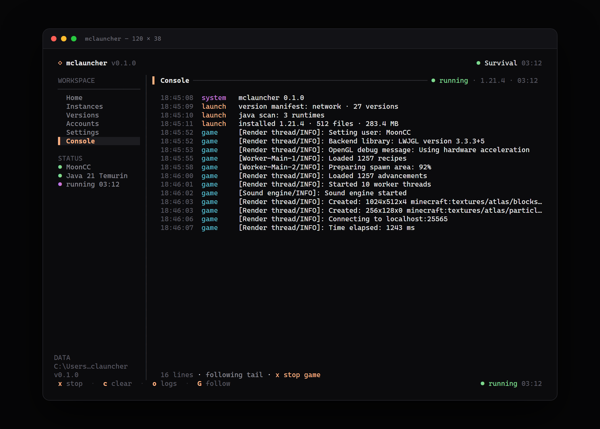
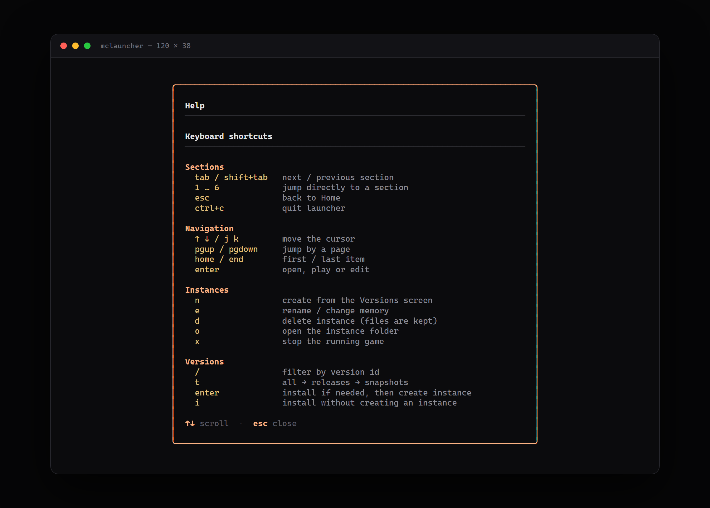
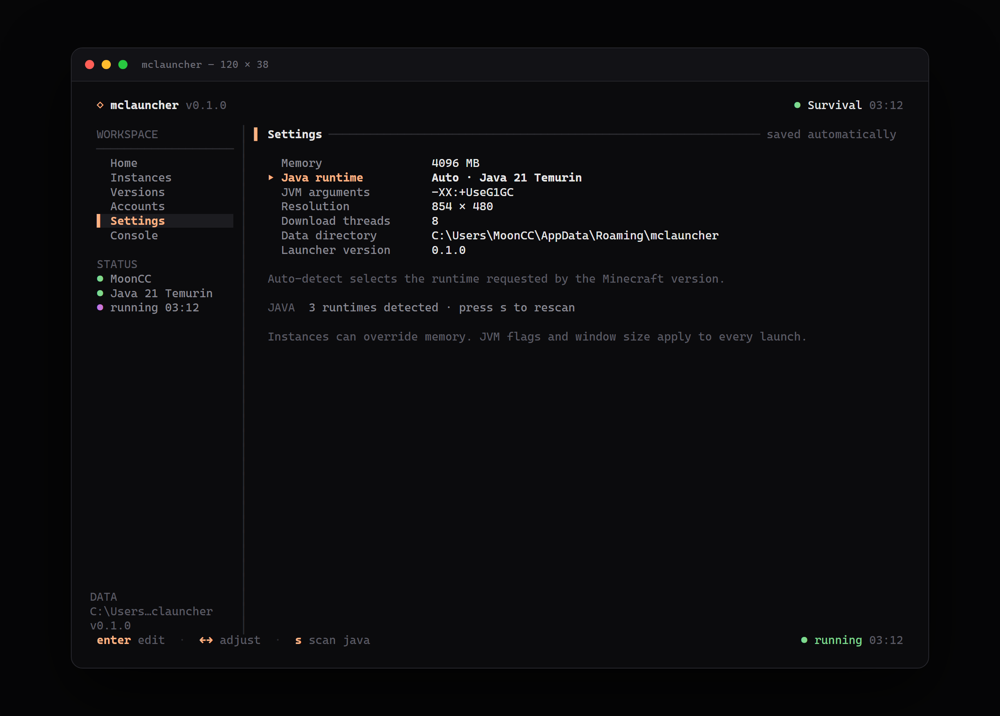
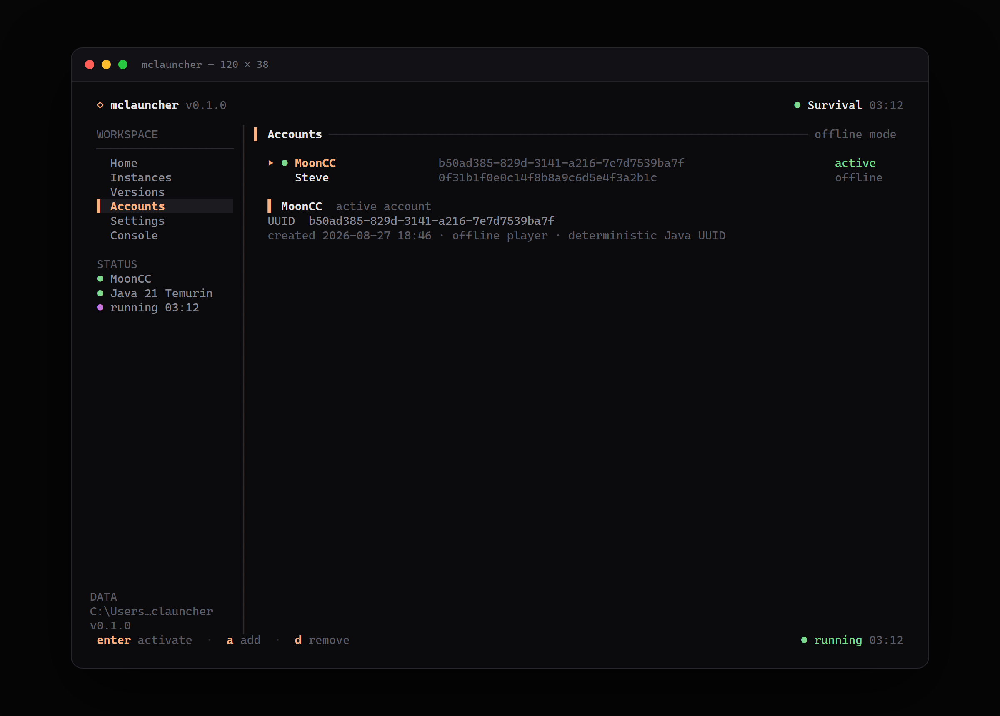
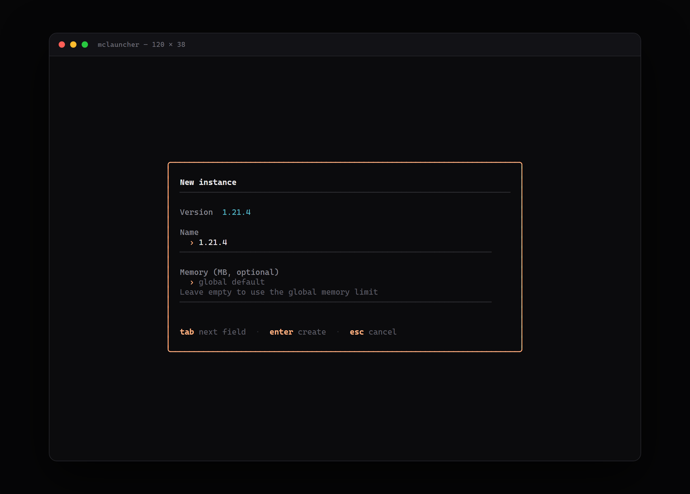
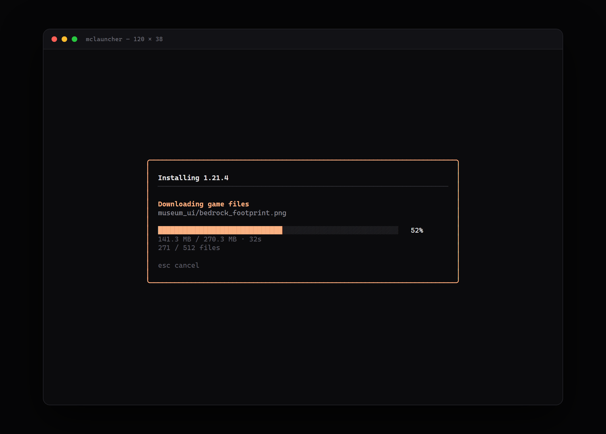

# mclauncher

> 一个 OpenCode 风格的 Minecraft 终端启动器。纯 Go 编写，单文件运行。

[](https://github.com/MoonCC233/MCLauncher-TUI/actions/workflows/ci.yml)
[](https://github.com/MoonCC233/MCLauncher-TUI/actions/workflows/release.yml)
[](LICENSE)



## 功能

- **终端原生 TUI**：Bubble Tea + Lip Gloss，键盘驱动，窄终端自动收起侧栏。
- **原版版本安装**：从 Mojang `piston-meta` 获取版本清单，安装 client、libraries、assets、natives 与 log4j 配置。
- **共享依赖，独立实例**：libraries 和 assets 全局共享，每个实例拥有独立的游戏目录与存档。
- **离线账户**：按 Java 版离线 UUID 规则生成身份，支持多账户与快速切换。
- **Java 运行时管理**：自动扫描常见安装位置，也可手动指定；按版本要求选择 Java，并在版本过旧时提示。
- **实例参数覆盖**：全局内存、实例内存、额外 JVM 参数、游戏窗口尺寸。
- **可靠的下载**：多线程下载、SHA-1 校验、原子写入配置文件。
- **控制台**：实时显示游戏 stdout/stderr，支持滚动、清屏、停止游戏和打开日志目录。
- **原版覆盖范围**：正式版、快照与旧版本；旧版 assets 的 virtual / map_to_resources 索引也有处理。

## 界面预览

| 版本管理 | 实例管理 |
| --- | --- |
|  |  |

| 控制台 | 快捷键帮助 |
| --- | --- |
|  |  |

<details>
<summary>更多截图</summary>

| 设置 | 账户 |
| --- | --- |
|  |  |

| 新建实例 | 安装进度 |
| --- | --- |
|  |  |

</details>

## 安装

### 下载预编译版本

前往 [Releases](https://github.com/MoonCC233/MCLauncher-TUI/releases) 下载对应平台压缩包：

- Windows：`mclauncher_<version>_windows_amd64.zip`（ARM64 也有对应包）
- Linux：`mclauncher_<version>_linux_amd64.tar.gz`
- macOS：`mclauncher_<version>_darwin_amd64.tar.gz` / `arm64`

解压后直接运行：

```bash
# Linux / macOS
chmod +x mclauncher
./mclauncher
```

Windows 建议在 **Windows Terminal** 中运行 `mclauncher.exe`。传统 `cmd.exe` 对 ANSI 颜色和制表符的渲染可能不完整。

### 从源码构建

需要 Go **1.24.2** 或更高版本：

```bash
git clone https://github.com/MoonCC233/MCLauncher-TUI.git
cd MCLauncher-TUI
go build -o mclauncher ./cmd/mclauncher
./mclauncher
```

Windows 下输出文件为 `mclauncher.exe`。

### 前置条件

- **Java**：启动器不会自动下载 Java。请先安装对应版本所需的 JDK/JRE：
  - Minecraft 1.20.5+ / 1.21.x：通常需要 Java 21
  - Minecraft 1.18–1.20.4：通常需要 Java 17
  - 更旧的版本：通常需要 Java 8
- **网络**：首次加载版本清单和安装版本时需要访问 Mojang 的 `piston-meta`、`piston-data`、`resources`、`libraries` 服务。
- 现代终端：支持真彩色与完整 Unicode 制表符（Windows Terminal、iTerm2、Kitty、WezTerm 等）。

## 使用流程

1. **添加账户**  
   进入 `Accounts`，按 `a` 输入用户名。离线账户名需为 3–16 位字母、数字或下划线。按 `enter` 设为当前账户。

2. **安装版本**  
   进入 `Versions`，等待版本清单加载。使用 `/` 搜索，`t` 在“全部 / 正式版 / 快照”之间切换。  
   - `enter`：安装（如果尚未安装）并打开“新建实例”表单。  
   - `i`：仅安装，不创建实例。  
   - `r`：重新拉取 Mojang 版本清单。

3. **创建并启动实例**  
   在表单中填写实例名、可选内存上限，按 `enter` 创建。回到 `Instances` 或 `Home`，按 `enter` 启动。

4. **查看日志 / 停止游戏**  
   进入 `Console` 查看实时输出。按 `x` 停止游戏进程，按 `o` 打开日志目录。

5. **调整设置**  
   在 `Settings` 中调整全局内存、Java 运行时、JVM 参数、窗口尺寸和下载线程数。进入某一行按 `enter` 编辑，内存和线程数也可用 `←` / `→` 或 `-` / `+` 调整。

## 快捷键

| 键 | 作用 |
| --- | --- |
| `tab` / `shift+tab` | 切换页面 |
| `1` … `6` | 直接跳转到指定页面 |
| `↑` `↓` / `k` `j` | 移动光标 |
| `pgup` / `pgdown` | 翻页 |
| `home` / `end` | 跳到首项 / 末项 |
| `enter` | 打开、启动或编辑 |
| `esc` | 返回 Home / 关闭弹窗 |
| `?` | 打开快捷键帮助 |
| `ctrl+c` | 退出启动器 |

页面专用按键：

| 页面 | 键与作用 |
| --- | --- |
| Instances | `n` 新建实例 · `e` 编辑 · `d` 删除（保留游戏文件）· `o` 打开实例目录 · `x` 停止游戏 |
| Versions | `/` 筛选 · `t` 切换类型 · `enter` 安装并创建实例 · `i` 仅安装 · `r` 刷新 · `o` 打开版本目录 |
| Accounts | `a` / `n` 添加离线账户 · `enter` 设为当前 · `d` 移除账户 |
| Settings | `enter` 编辑 · `s` / `r` 重新扫描 Java · `←` `→` / `-` `+` 调整数值 · `o` 打开数据目录 |
| Console | `x` 停止游戏 · `c` 清屏 · `o` 打开日志目录 · `G` / `end` 跟随最新日志 |

## 数据目录

默认位置：

| 平台 | 路径 |
| --- | --- |
| Windows | `%APPDATA%\mclauncher` |
| macOS | `~/Library/Application Support/mclauncher` |
| Linux | `$XDG_DATA_HOME/mclauncher` 或 `~/.local/share/mclauncher` |

可通过环境变量或命令行参数覆盖：

```bash
MCLAUNCHER_DATA_DIR=D:\MCLauncher ./mclauncher
./mclauncher --data-dir ./portable-data
```

目录结构：

```text
mclauncher/
├── config.json                 # 账户、实例与设置
├── versions/<id>/              # 版本 JSON、client jar、natives、安装标记
├── libraries/                  # 全局共享依赖
├── assets/
│   ├── indexes/
│   ├── objects/
│   ├── virtual/                # 旧版本虚拟资源
│   └── log_configs/
├── instances/<id>/             # 每个实例独立的游戏目录（存档、模组、截图等）
├── logs/
└── cache/
```

删除实例只会从启动器配置中移除条目，`instances/<id>/` 中的文件会保留。

## 命令行参数

```text
--data-dir <path>       覆盖数据目录
--version               打印版本并退出
--preview               渲染一帧静态界面到 stdout
--preview-screen <name> home | instances | versions | accounts | settings | console | help | form | progress
--width <n>             预览宽度（默认 120）
--height <n>            预览高度（默认 38）
```

`--preview` 不需要真实终端，适合在 CI 或文档构建中生成界面截图。

## 开发

```bash
gofmt -w .
go vet ./...
go test ./...
go build ./...
```

项目结构：

```text
cmd/mclauncher/         程序入口、参数解析、配置引导
internal/tui/           Bubble Tea 模型、页面、弹窗与预览数据
internal/mojang/        版本清单、规则判断、参数替换、依赖解析、natives 解压
internal/install/       下载、校验、资源索引与安装标记
internal/launch/        Java 命令行构建、进程启动、输出流
internal/java/          Java 运行时扫描、版本解析与选择
internal/config/        配置持久化、账户与实例管理
internal/auth/          离线用户名校验与离线 UUID
internal/paths/         数据目录布局
internal/util/          路径安全、原子 JSON、参数解析、格式化
internal/version/       版本注入
scripts/ansi2html.go    预览 ANSI 转 HTML（生成文档截图用）
```

生成文档截图（Windows + Edge 示例）：

```powershell
go build -o mclauncher.exe ./cmd/mclauncher
mclauncher.exe --preview --preview-screen home --width 120 --height 38 > preview-home.ansi
go run scripts/ansi2html.go preview-home.ansi preview-home.html mclauncher
# 再用浏览器无头模式将 preview-home.html 渲染为 PNG
```

## 发布

推送 `v*` 标签即可触发 GitHub Actions 中的 GoReleaser：

```bash
git tag v0.1.0
git push origin v0.1.0
```

发布流水线会构建以下目标，并生成校验和：

- `windows/amd64`、`windows/arm64`
- `linux/amd64`、`linux/arm64`
- `darwin/amd64`、`darwin/arm64`

压缩包内含 `mclauncher` 可执行文件、`README.md` 和 `LICENSE`。

## 已知限制

- **仅支持离线账户**：未实现 Microsoft / OAuth 登录，`auth_access_token` 固定为占位值。
- **仅支持 Minecraft 原版**：尚未集成 Forge、Fabric、Quilt、OptiFine 等模组加载器。
- **不管理 Java 安装**：只检测和选择已安装的 Java；不会下载 JDK。
- **退出启动器不会终止游戏**：启动器退出后游戏继续运行，但后续 stdout/stderr 输出可能丢失。需要停止游戏时请先在 Console 中按 `x`。
- **无自动更新**：请关注 Releases 页面获取新版本。
- **预编译二进制未签名**：macOS 首次运行可能需要 `xattr -d com.apple.quarantine ./mclauncher`。

## 致谢

界面风格受 [OpenCode](https://github.com/sst/opencode) 启发；TUI 基于 [Bubble Tea](https://github.com/charmbracelet/bubbletea)、[Bubbles](https://github.com/charmbracelet/bubbles) 和 [Lip Gloss](https://github.com/charmbracelet/lipgloss)。

本项目与 Mojang Studios / Microsoft 无关联。使用 Minecraft 客户端及资源时请遵守 [Minecraft EULA](https://www.minecraft.net/eula)。

## License

[MIT](LICENSE) © 2026 MoonCC233
